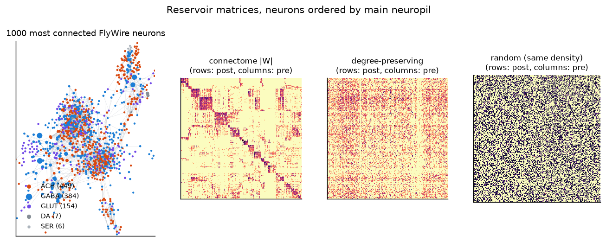
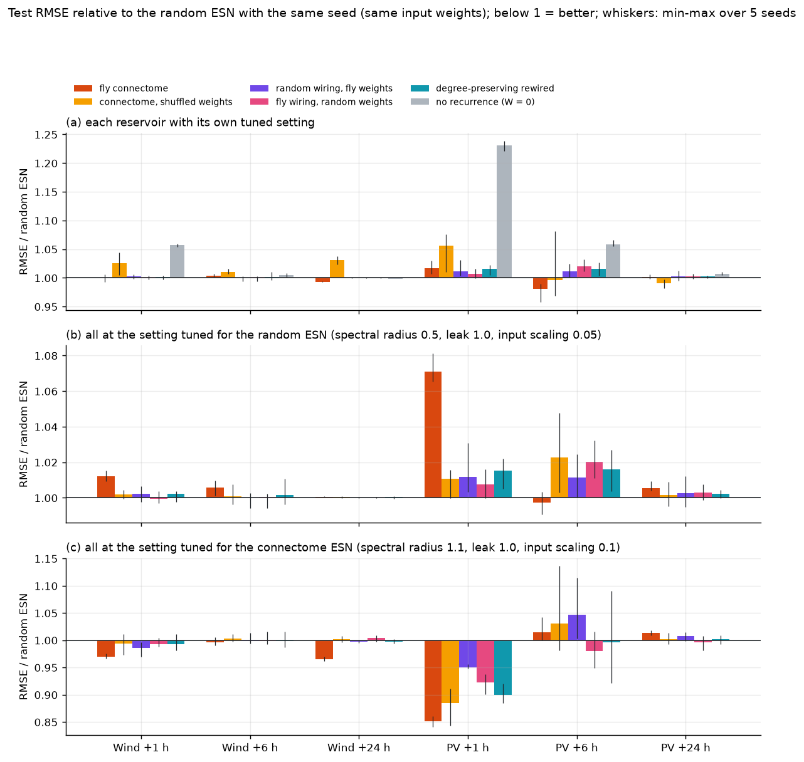
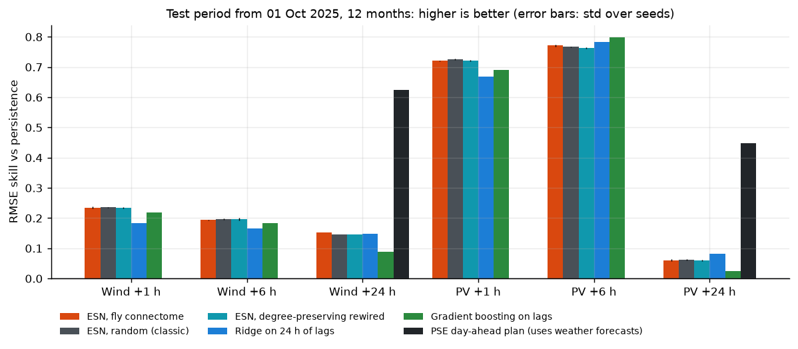
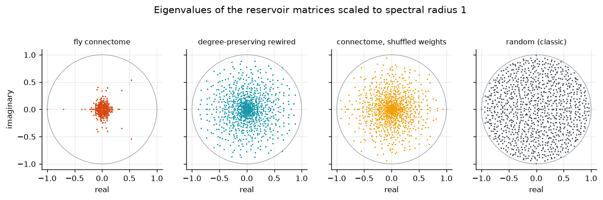
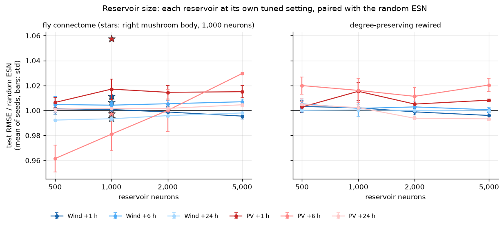
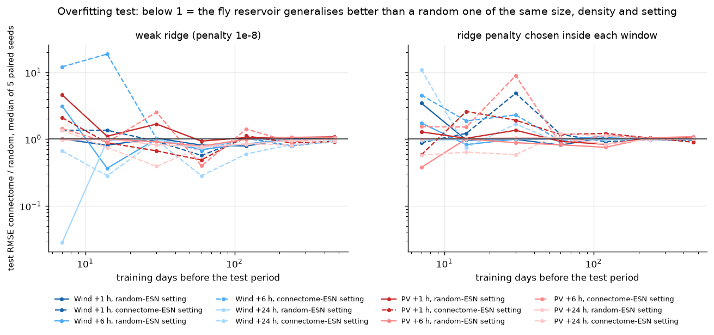
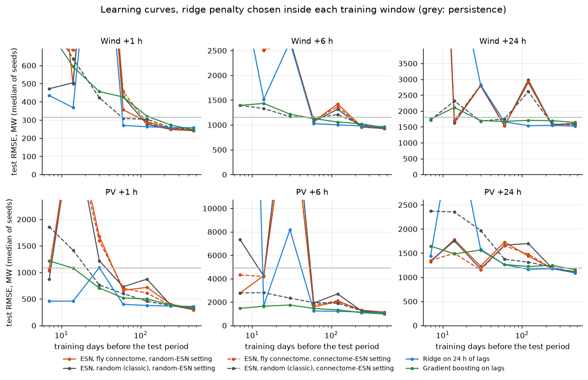
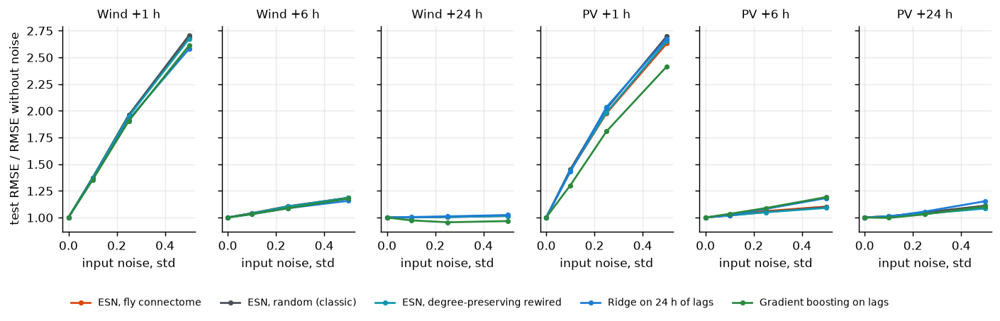
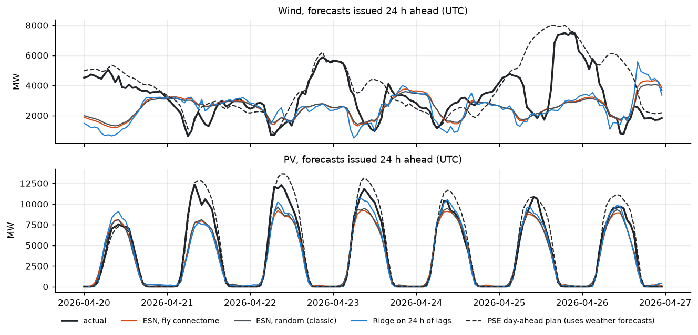

# fly-connectome-forecast


**Dashboard: https://kwwaleszczynski-del.github.io/fly-connectome-forecast/**

Can the wiring diagram of a fruit-fly brain forecast Polish wind and solar power? This project takes real
neuron-to-neuron connections from the **FlyWire whole-brain connectome** of *Drosophila melanogaster*, uses them as
the fixed recurrent layer of an **echo state network** (ESN), and forecasts national wind and PV generation in
Poland 1, 6 and 24 hours ahead. The fly reservoir is tested against random reservoirs of the same size and density,
against rewired and reshuffled versions of itself, and against the forecasts a practitioner would actually use.



## Short answer

**No. Once each reservoir is tuned, the fly wiring forecasts Polish wind and PV as well as a random reservoir of
the same size and density, not better.** Over six tasks (wind and PV, 1, 6 and 24 hours ahead) on a 12-month test
period, a 1,000-neuron connectome ESN has a test RMSE within -2% to +2% of the random ESN's (mean ratio 1.000 over
the six tasks, 5 paired seeds; -4% to +6% across all sizes and the mushroom-body reservoir). The sign changes between
tasks and between reservoir sizes, so this is not a fly advantage.

- **Where it differs: robustness, not accuracy.** Scaled to the same spectral radius, the connectome matrix has
  almost all eigenvalues far inside it (0.4% above half the radius, against 72% for a random matrix). It therefore
  tolerates a spectral radius above 1, where random reservoirs degrade. At that shared setting it beats the random
  ESN by up to 15% (PV +1 h), and so do the shuffled and rewired versions of the connectome (10-12%). At the classic
  random-ESN setting the sign flips: 7% worse at PV +1 h, in all 5 seeds.
- **Overfitting resistance (Costi et al.) does not carry over.** With the ridge penalty chosen inside each training
  window, the learning curves show no consistent advantage. With an almost unregularised readout there is a weak,
  seed-dependent one (connectome better in 21 to 23 of 36 window x task cells). Input noise hurts all reservoirs
  equally.
- **As forecasters, all ESNs are good short-horizon models.** Among history-only models they are best at +1 h
  (wind 241 MW RMSE against 246 for gradient boosting and 257 for ridge; PV about 300 against 334 and 358) and at
  wind +6 h. They lose to gradient boosting at PV +6 h and to ridge at PV +24 h. None comes near the **PSE
  day-ahead plan** at +24 h (wind 678 against 1,529 MW), which uses weather forecasts that no model here sees.
- **Recurrence matters, wiring does not.** Removing the recurrent matrix altogether ($`W = 0`$) costs 23% at PV
  +1 h and 6% at wind +1 h. Replacing it with any of five random or rewired variants changes almost nothing.

A negative result, then, but a useful one: for these series the reservoir's spectrum and hyperparameters matter
far more than where its connections come from.



## The problem

Reservoir computing trains only a linear readout on top of a large, fixed, random recurrent network. Which fixed
network works best is an open question, and the connectomes released since 2024 offer a tempting candidate:
wiring shaped by evolution rather than by a random number generator. Costi et al. (2025, ESA Advanced Concepts
Team) used the FlyWire connectome as an ESN reservoir for a chaotic orbital-mechanics benchmark and found it more
resistant to overfitting than a classic random ESN, with both the topology and the synaptic weights contributing.
An earlier preprint (Morra and Daley 2022) reported equal or lower error with lower variance for a "fruit fly ESN"
on chaotic series.

Those results are on clean, simulated, chaotic systems. Energy time series are different: strongly periodic,
noisy, driven by weather the network never sees, and with a non-stationary installed base. The question here is
plain: **on real national wind and PV data, with a fair protocol, does the fly wiring help, and if so where?**

## Method

**Connectome.** FlyWire release v783 (Zenodo record 10676866, CC BY 4.0), table
`proofread_connections_783.feather`: one row per presynaptic neuron, postsynaptic neuron and neuropil, with the
synapse count and the mean predicted transmitter probabilities. Rows are summed per neuron pair; pairs with fewer
than 5 synapses (the threshold used in the FlyWire papers) and autapses are dropped. Each neuron gets one
transmitter (Dale's principle): the one with the highest synapse-weighted probability over its outgoing synapses.
Acetylcholine is excitatory, GABA and glutamate inhibitory (glutamate acts mainly through the inhibitory GluCl
channel in the fly brain, as in the whole-brain model of Shiu et al. 2024; Costi et al. treated it as excitatory);
outputs of dopaminergic, serotonergic and octopaminergic neurons are removed, as in Costi et al. The weight of a
connection from neuron $`j`$ to neuron $`i`$ is

```math
W_{ij} = s_j \, n_{ij}
```

with $`s_j \in \{+1, -1\}`$ the sign of the presynaptic neuron and $`n_{ij}`$ the synapse count. Reservoirs are the
induced subgraphs of the $`N`$ = 500, 1,000, 2,000 and 5,000 neurons with the most synapses (main experiments:
1,000), and a regional one: the 1,000 neurons with the most synapses inside the **right mushroom body** (neuropils
MB_CA_R, MB_PED_R, MB_VL_R, MB_ML_R; only synapses inside those neuropils), the fly's centre for associative
learning. The subgraphs are committed in [`connectome/`](connectome/) with their attribution.

**Echo state network.** With input $`u_t`$ (a constant 1, z-scored national wind, PV and demand at hour $`t`$,
sine and cosine of the hour of day and of the day of year), the reservoir state evolves as

```math
x_t = (1 - a)\, x_{t-1} + a \tanh\left( \rho \, \frac{W}{\lambda_{\max}(W)} \, x_{t-1} + \sigma \, W_{\mathrm{in}} \, u_t \right)
```

where $`\lambda_{\max}`$ is the spectral radius, so every reservoir is scaled to the same spectral radius $`\rho`$;
$`a`$ is the leak rate, $`\sigma`$ the input scaling and $`W_{\mathrm{in}}`$ a dense matrix of $`U(-1, 1)`$ entries
that depends only on the random seed. A ridge readout maps $`[x_t, u_t]`$ to the six targets
$`y_{t+h}`$ (wind and PV, $`h`$ = 1, 6, 24 h) with a penalty $`\alpha`$ per sample and target:

```math
\hat\beta = \arg\min_\beta \; \lVert Y - F\beta \rVert^2 + \alpha \, T \, \lVert \beta \rVert^2
```

**Controls** (all with the same $`N`$, the same number of connections, the same $`W_{\mathrm{in}}`$ for a given
seed, and the same spectral radius; following the topology x weights design of Costi et al.):

| reservoir | topology | weights |
|---|---|---|
| connectome | FlyWire | FlyWire (signed synapse counts) |
| random (classic ESN) | Erdos-Renyi | $`U(-1, 1)`$ |
| shuffled | FlyWire | FlyWire values permuted over the connections |
| random topology | Erdos-Renyi | FlyWire values on random connections |
| topology, random weights | FlyWire | $`U(-1, 1)`$ |
| degree-preserving | FlyWire rewired by double-edge swaps (10 per connection) keeping every neuron's in- and out-degree | each connection keeps the weight of its presynaptic neuron, so out-strength and sign per neuron are kept |
| no recurrence | none ($`W = 0`$) | - |

The last one asks whether recurrence is needed at all: the readout then sees only leaky-filtered inputs.

**Data.** Public PSE reports API, 14 June 2024 to 2 October 2026, averaged to hours (UTC): national wind and PV
generation and demand (`his-wlk-cal`), and the PSE **day-ahead coordination plan** (`pdgopkd`, fields `gen_wi`,
`gen_fv`), published on the day before delivery, mostly between 15:30 and 20:30 local time.

**Protocol.** Train from 20 June 2024 (after a one-week washout of the reservoir) to 31 March 2025, validation
1 April to 30 September 2025, test 1 October 2025 to 30 September 2026 (8,760 target hours per task). Training rows
never have a target beyond the end of their window. For each reservoir type the spectral radius
($`\rho`$ = 0.5, 0.9, 0.99, 1.1), leak rate ($`a`$ = 0.1, 0.3, 0.6, 1.0) and input scaling
($`\sigma`$ = 0.02, 0.05, 0.1, 0.5, 1.0) are chosen on validation at $`N`$ = 1,000 with seed 0 (500 settings), and
$`\alpha`$ per target from $`10^{-10} \dots 10^{2}`$. Models are then refitted on train + validation and scored once
on the test year: 5 seeds per setting (3 for $`N`$ = 5,000). Forecasts are clipped at 0 MW; a forecast that
diverges to infinity or NaN is scored as an infinite error, not skipped. Two comparisons are run:

- **own setting**: every reservoir type with its own best setting, the fair comparison for forecasting;
- **matched setting**: every reservoir type at the setting selected for the connectome, and again at the setting
  selected for the random ESN (each with its own best $`\alpha`$ at that point of the grid). Only the matrix
  differs, as in Costi et al.

**Baselines.** Persistence $`\hat y_{t+h} = y_t`$; persistence of the same hour yesterday; ridge regression on the
last 24 hours of wind and PV, current demand and the calendar terms; gradient boosting (scikit-learn
`HistGradientBoostingRegressor`) on the same lags and the hour of day; and the PSE day-ahead plan. The PSE plan is
not a fair opponent for history-only models: it is built from numerical weather forecasts and its lead time is
4 to 32 hours, so it is shown as the practical benchmark for the +24 h horizon.

**Metrics.** MAE and RMSE in MW over all hours of the test year (night hours included for PV), and the skill score

```math
\mathrm{SS} = 1 - \frac{\mathrm{RMSE}_{\mathrm{model}}}{\mathrm{RMSE}_{\mathrm{persistence}}}
```

Variants are compared with the random ESN of the same seed (the ratio of test RMSE), with the spread over seeds,
and with a 95% bootstrap interval of the RMSE difference that resamples whole test days.

**Overfitting.** (1) Learning curves at both matched settings: training windows of the last 7, 14, 30, 60, 120,
240 days and all data before the test year, with every fixed $`\alpha`$ and with $`\alpha`$ chosen inside the window
(fitted on its first 80%, scored on its last 20%, then refitted on the whole window); train and test error are
recorded and the connectome is compared with the random reservoir of the same seed (median of the 5 paired ratios).
(2) Input noise: Gaussian noise of 0.1, 0.25 and 0.5 standard deviations on the observed wind, PV and demand inputs
(training and test), clean targets, every reservoir at its own setting.

## Results

All numbers are for the test period 1 October 2025 to 30 September 2026 (8,760 target hours per task); every table
is in [`results/`](results/), the key numbers in [`results/summary.json`](results/summary.json).

**The reservoirs.** The thresholded whole-brain graph has 133,383 neurons, 2,664,099 connections and 33.6 million
synapses (after removing modulatory outputs). The 1,000 most connected neurons keep 20,055 connections (density 2.0%),
mostly from the anterior ventrolateral protocerebrum (AVLP), the gnathal ganglion and the optic lobes; 54% of them are
inhibitory (GABA or glutamate). The right mushroom body reservoir (1,000 neurons, 11,469 connections) is almost purely
excitatory (5% inhibitory): Kenyon cells, projection neurons from the antennal lobe and output neurons.

**Forecast skill**, RMSE in MW and skill against persistence, reservoirs of 1,000 neurons, each at its own tuned
setting (mean of 5 seeds; seed spreads are 0-6 MW except PV +6 h, 4-16 MW):

| model | wind +1 h | wind +6 h | wind +24 h | PV +1 h | PV +6 h | PV +24 h |
|---|---:|---:|---:|---:|---:|---:|
| persistence | 315 | 1,153 | 1,802 | 1,077 | 4,882 | 1,186 |
| persistence, same hour yesterday | 1,802 (-4.73) | 1,802 (-0.56) | 1,802 (0.00) | 1,186 (-0.10) | 1,186 (0.76) | 1,186 (0.00) |
| ridge on 24 h of lags | 257 (0.18) | 963 (0.17) | 1,536 (0.15) | 358 (0.67) | 1,065 (0.78) | **1,090 (0.08)** |
| gradient boosting on lags | 246 (0.22) | 943 (0.18) | 1,641 (0.09) | 334 (0.69) | **983 (0.80)** | 1,157 (0.02) |
| **ESN, fly connectome** | **241 (0.23)** | 930 (0.19) | **1,529 (0.15)** | 301 (0.72) | 1,119 (0.77) | 1,114 (0.06) |
| ESN, random (classic) | **241 (0.24)** | **926 (0.20)** | 1,539 (0.15) | **296 (0.73)** | 1,141 (0.77) | 1,112 (0.06) |
| ESN, degree-preserving rewired | 241 (0.23) | 928 (0.20) | 1,539 (0.15) | 300 (0.72) | 1,159 (0.76) | 1,115 (0.06) |
| ESN, no recurrence | 255 (0.19) | 930 (0.19) | 1,536 (0.15) | 364 (0.66) | 1,208 (0.75) | 1,120 (0.06) |
| PSE day-ahead plan (weather forecasts, lead 4-32 h) | | | *678 (0.62)* | | | *655 (0.45)* |



The ESNs are the best history-only models at +1 h and for wind at +6 h. With the selected short memory (leak rate 1
and a small input scaling, i.e. an almost linear reservoir that forgets within a few hours) they do worse at PV +6 h,
where the useful information is yesterday's output at the target hour; gradient boosting and ridge, which see the
last 24 hours explicitly, win there. At +24 h no history-only model gets much past persistence (skill 0.06-0.15),
while the PSE plan, built on weather forecasts, has a skill of 0.62 for wind and 0.45 for PV.

**Does the wiring matter?** The figure under the short answer compares each reservoir with the random ESN of the
same seed, which has the same input weights, so the ratio isolates the recurrent matrix. (a) With each reservoir at
its own tuned setting the connectome is better in all 5 seeds at wind +24 h (-0.7%) and PV +6 h (-1.9%), worse in
all 5 seeds at PV +1 h (+1.7%), and level elsewhere. For seed 0 the 95% bootstrap intervals of the RMSE difference
(resampling test days) agree: -19 to -1 MW at wind +24 h, -21 to -4 MW at PV +6 h, +2 to +8 MW at PV +1 h, and
including zero for the other three tasks. (b) At the setting tuned for the random ESN (spectral radius 0.5, input
scaling 0.05) the connectome is the worst of all reservoirs at PV +1 h (+7%). (c) At the setting tuned for the
connectome (spectral radius 1.1, input scaling 0.1) the random ESN degrades and every other variant beats it at
PV +1 h, the connectome most (-15%), with smaller gains at wind +1 h (-3%) and wind +24 h (-3%). On validation the
two best settings are almost equally good: 0.6375 for the connectome at its setting and 0.6402 for the random ESN at
its own (mean RMSE ratio to persistence over six tasks).

**Why: the spectrum.** Synapse counts are heavy-tailed (median 16, maximum 2,405 synapses per connection in the
1,000-neuron graph), and a few strongly connected, strongly recurrent groups of neurons dominate the matrix. After
scaling to spectral radius 1, only 0.4% of the connectome's eigenvalues lie above 0.5 (random ESN: 72%, degree-
preserving: 25%, shuffled weights: 23%) and a single eigenvalue lies above 1/1.1. At spectral radius 1.1 the
connectome therefore has one unstable mode that saturates while the bulk stays strongly contracting, whereas a random
matrix pushes about 100 modes past the edge of stability. Normalising by the spectral radius, the standard ESN recipe,
gives the connectome much less effective memory than a random matrix with the same nominal radius. That is why
it wants a larger radius, and why it is more forgiving there.



**Size and region.** From 500 to 5,000 neurons the picture stays the same: ratios between 0.96 and 1.03 with
changing signs, and no trend towards a fly advantage in larger reservoirs. The mushroom-body reservoir is within
about 1% of random except at PV +1 h (+6%).



**Overfitting.** Costi et al. found the connectome reservoir more resistant to overfitting. Here, with both reservoirs
at the same setting and paired by seed, the ratio of test errors over training windows of 7 to 240 days (36 window x
task cells per setting) is:

| setting | ridge penalty | cells with median ratio < 1 | connectome better in all 5 seeds | worse in all 5 seeds | geometric mean ratio |
|---|---|---:|---:|---:|---:|
| connectome's | 1e-8 (almost none) | 23 | 14 | 7 | 0.98 |
| random ESN's | 1e-8 (almost none) | 21 | 16 | 12 | 0.90 |
| connectome's | chosen inside the window | 14 | 11 | 12 | 1.34 |
| random ESN's | chosen inside the window | 20 | 12 | 10 | 1.01 |

With an almost unregularised readout there is a weak tendency in the connectome's favour; as soon as the penalty is
chosen properly it disappears. The mechanism is visible in the training error: at the same setting the connectome
fits the training window less closely (median training RMSE 1.1 times the random reservoir's at the random-ESN
setting and 2.9 times at its own setting, with the almost unregularised readout). Its concentrated spectrum leaves
fewer effective degrees of freedom, which acts like a built-in regulariser. That helps only when nothing else
regularises the readout, and a tuned ridge penalty does the same job better. Below about 60 days
of training every linear readout, ridge included, extrapolates badly to a whole year (a few weeks of late summer do
not describe winter), so the ratios there are dominated by occasional blow-ups rather than by the wiring; gradient
boosting degrades most gracefully.





**Noisy inputs.** With Gaussian noise of 0.5 standard deviations on the observed inputs, the +1 h errors grow by a
factor of 2.6-2.7 for every reservoir (connectome 2.69 and 2.63, random 2.71 and 2.70 for wind and PV) and by
1.0-1.2 at longer horizons, the same as for ridge and gradient boosting.



**What the forecasts look like.** At +24 h the history-only models mostly reproduce the daily PV shape and the
recent wind level; the PSE plan follows the weather.



The [dashboard](https://kwwaleszczynski-del.github.io/fly-connectome-forecast/) shows the reservoir network
(hover a neuron for its FlyWire root id), all controls, the learning curves per task and a forecast explorer for
the whole test year, in light and dark mode.

## Limitations

- **History only.** All models here see past generation, demand and the calendar, no weather forecasts. That
  caps their skill at +24 h, which is why the PSE plan (built on numerical weather prediction) is far ahead there.
  The question is about the reservoir, not about building the best possible forecast.
- **One country, one test year.** National totals are smooth; a single wind farm or PV plant is noisier and
  could favour different models. The test year (October 2025 to September 2026) is one weather realisation, and
  installed PV capacity grows by several GW per year, which all models only see through the level of recent output.
- **Tuning at one size.** Hyperparameters are selected per reservoir type at 1,000 neurons with one seed and
  reused for the other sizes and the mushroom-body reservoir; a full search per size could change the size curve.
- **Connectome processing is a modelling choice.** Synapse counts as weights, one transmitter per neuron,
  glutamate as inhibitory, removal of modulatory outputs, the 5-synapse threshold and "most synapses" as the
  selection rule are all simplifications. The rate neurons share one time constant and a tanh nonlinearity; nothing
  here simulates the fly's actual neuronal dynamics, and the reservoir is rescaled to a spectral radius chosen for
  forecasting, not for biology.
- **One brain.** Only the adult female brain of FlyWire v783 is used. A male whole central nervous system connectome
  (brain and nerve cord, [male-cns.janelia.org](https://male-cns.janelia.org/), CC BY) has since been released and
  could be tested the same way; so could other weightings (for example synapse counts normalised per
  postsynaptic neuron), which change the spectrum that this result hinges on.
- **Statistics.** Seed spreads cover only the random parts (input weights, control matrices); the day-block
  bootstrap covers sampling of test days for seed 0. Neither covers the choice of test year.
- **Data definitions.** PSE reports national wind and PV including units outside the balancing market; how the
  output of small distributed PV is estimated is not documented in the report. The PSE plan is the version
  published on D-1, so its lead time varies between about 4 and 32 hours.

Grid rules, reporting and the PSE plans change over time and should be checked against current sources before
reusing these results. Nothing here is investment advice.

## Data sources and licences

**FlyWire connectome.** FlyWire Consortium, *FlyWire Whole-brain Connectome Connectivity Data*, version 783,
Zenodo 2024, doi:[10.5281/zenodo.10676866](https://doi.org/10.5281/zenodo.10676866), licence
[CC BY 4.0](https://creativecommons.org/licenses/by/4.0/). Only `proofread_connections_783.feather` (852 MB,
downloaded once into `data/flywire/`, MD5 checked, not part of this repository) is used. The repository contains
small derived subgraphs in [`connectome/`](connectome/) (CC BY 4.0, changes described in
[`connectome/README.md`](connectome/README.md)). Please cite:

- Dorkenwald, S. et al. (2024). Neuronal wiring diagram of an adult brain. *Nature* 634, 124-138.
  doi:[10.1038/s41586-024-07558-y](https://doi.org/10.1038/s41586-024-07558-y)
- Schlegel, P. et al. (2024). Whole-brain annotation and multi-connectome cell typing of *Drosophila*.
  *Nature* 634, 139-152. doi:[10.1038/s41586-024-07686-5](https://doi.org/10.1038/s41586-024-07686-5)
- Eckstein, N., Bates, A. S. et al. (2024). Neurotransmitter classification from electron microscopy images at
  synaptic sites in *Drosophila melanogaster*. *Cell* 187, 2574-2594 (transmitter predictions).

**PSE.** Public reports of PSE S.A. (Polskie Sieci Elektroenergetyczne, the Polish transmission system operator),
API `https://api.raporty.pse.pl/api`, no key:

| Report | Fields used | Meaning |
|---|---|---|
| `his-wlk-cal` ("Wielkości podstawowe") | `wi`, `pv`, `demand` | national wind and PV generation (units on and off the balancing market) and demand, MW, 15 min |
| `pdgopkd` (day-ahead coordination plan, PKD) | `gen_wi`, `gen_fv` | planned wind and PV generation for day D, published on D-1, MW, 15 min |

`dtime_utc` is the **end** of each 15-minute interval; the code converts it to the interval start and averages to
hours. The data are cached as monthly Parquet files in `data/pse/`, not part of the repository.

**Terms of use.** PSE publishes conditions for re-using public sector information
([www.pse.pl, BIP, "Ponowne wykorzystywanie informacji sektora publicznego"](https://www.pse.pl/bip/ponowne-wykorzystanie-informacji-publicznej)):
commercial and non-commercial re-use free of charge, on condition that the source and the date the information was
obtained are named, the PSE logo is removed, and recipients are told when and how the information has been
processed, without misleading them. These conditions are written for www.pse.pl; this project applies them to the
reports API of the same operator. Attribution as required:

> Information obtained from www.pse.pl (PSE S.A. reports `his-wlk-cal` and `pdgopkd`), state as of 26 October
> 2026. The information has been processed: averaged to hours, used to train forecasting models and compared with
> their forecasts. It is not an official PSE publication.

The repository contains no raw PSE data, only derived statistics in `results/` and `docs/`.

## References

- Costi, L., Hadjiivanov, A., Dold, D., Hale, Z. F., Izzo, D. (2025). The *Drosophila* connectome as a
  computational reservoir for time-series prediction. *Biomimetics* 10(5), 341.
  doi:[10.3390/biomimetics10050341](https://doi.org/10.3390/biomimetics10050341)
- Morra, J., Daley, M. (2022). Imposing connectome-derived topology on an echo state network.
  arXiv:[2201.09359](https://arxiv.org/abs/2201.09359)
- Shiu, P. K. et al. (2024). A *Drosophila* computational brain model reveals sensorimotor processing.
  *Nature* 634, 210-219.
- Jaeger, H. (2001). The "echo state" approach to analysing and training recurrent neural networks.
  GMD Report 148.
- Lukoševičius, M. (2012). A practical guide to applying echo state networks. In *Neural Networks: Tricks of the
  Trade*, Springer, 659-686.

## Usage

```bash
python -m venv .venv
.venv/Scripts/python -m pip install -e ".[dev]"      # Linux/macOS: .venv/bin/python

python -m fly_forecast fetch                 # PSE series into data/pse (~5 MB)
python -m fly_forecast connectome            # FlyWire table (852 MB, once) -> connectome/ subgraphs
python -m fly_forecast run --jobs 4          # experiments -> results/
python -m fly_forecast report                # tables, docs/img/*.png, docs/index.html
pytest -q                                    # synthetic data, no network
```

`run` and `report` only need the committed subgraphs in `connectome/` and the PSE cache, not the FlyWire download.

```
src/fly_forecast/
  pse.py          PSE API client with monthly Parquet cache, hourly means
  connectome.py   FlyWire table -> signed, thresholded pair graph -> reservoir subgraphs
  reservoir.py    spectral scaling and the control reservoirs (random, shuffled, rewired, ...)
  esn.py          leaky ESN state update and ridge readout for many penalties at once
  data.py         inputs, targets, train / validation / test windows
  baselines.py    persistence, ridge and gradient boosting on lags, PSE day-ahead plan
  experiment.py   tuning, main comparison, learning curves, input noise (multiprocessing)
  metrics.py      MAE, RMSE, skill, daily block bootstrap
  report.py       summary tables; figures.py README figures; dashboard.py static page (Plotly.js)
  cli.py          fetch | connectome | run | report | all
```

**GitHub Pages.** `docs/` holds the dashboard; serve it with Settings > Pages > Deploy from a branch, `main`,
`/docs`. Nothing is refreshed automatically: the results are a fixed experiment.

## License

Code: MIT, see [LICENSE](LICENSE). Connectome-derived files in `connectome/`: CC BY 4.0, FlyWire Consortium (see
above). PSE data: see [Data sources and licences](#data-sources-and-licences).
